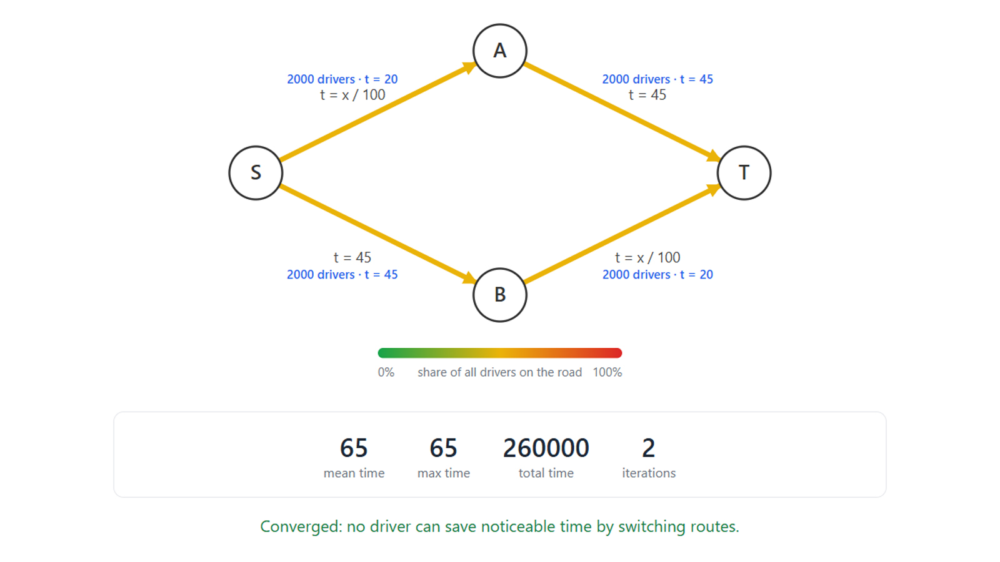

# Road Network Lab

A C# traffic simulation demonstrating **Braess's paradox**: adding a road can make traffic worse for everyone.

<p align="center">
  <a href="https://mykulakov.github.io/road-network-lab/">
    
  </a>
</p>

## The idea

Drivers choose routes independently, trying to minimize their own travel time. At equilibrium, no driver can improve their journey by changing routes alone.

Braess's paradox demonstrates that adding a road can change this equilibrium for the worse — increasing travel time for everyone.

## The two scenarios

### Baseline — original network

The original network has four roads and two possible routes from `S` to `T`.



### Modified — additional connection

A new road connects `A` and `B`, creating an additional route.

## Results

For a demand of 4,000 drivers:

| Metric | Baseline | Modified |
|---|---:|---:|
| Average travel time | 65 | 80 |

Adding a road increases average travel time by **15 (23.08%)**. All 4,000 drivers experience a longer journey.

## Try it online

Open the [live application](https://mykulakov.github.io/road-network-lab/).

1. Select **Baseline** or **Modified**.
2. Set traffic demand and equilibrium tolerance.
3. Click **Run**.
4. Run both scenarios to compare their results.

The application visualizes road flows and travel times, reports simulation metrics, and indicates whether the equilibrium calculation converged.

The application runs in the browser using WebAssembly. No backend or database is required.

## Technology

- C# / .NET
- Blazor WebAssembly
- SVG
- Dijkstra's algorithm
- Method of Successive Averages (MSA)

## Run locally

Requires the .NET SDK.

```bash
git clone https://github.com/mykulakov/road-network-lab.git
cd road-network-lab
dotnet run --project RoadNetworkLab.Web
```

Run tests:

```bash
dotnet test
```

## Project structure

- `RoadNetworkLab.Core` — simulation logic.
- `RoadNetworkLab.Web` — Blazor WebAssembly application.
- `RoadNetworkLab.Tests` — automated tests.
- Console application — command-line interface.

## Version

Current release: **v0.2**.
